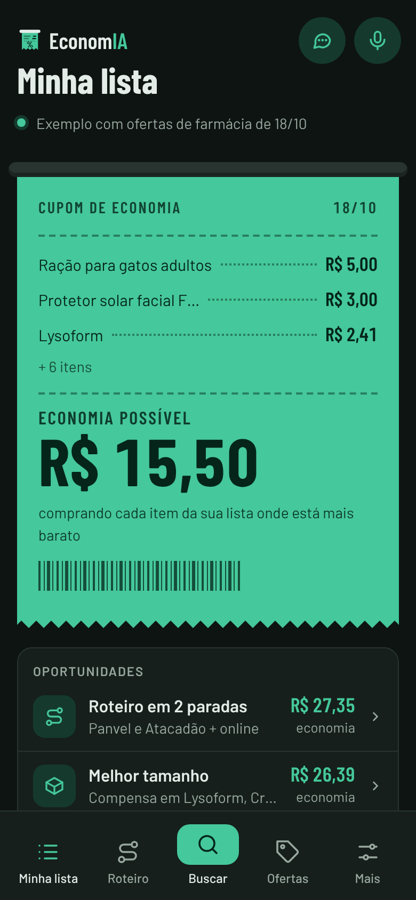
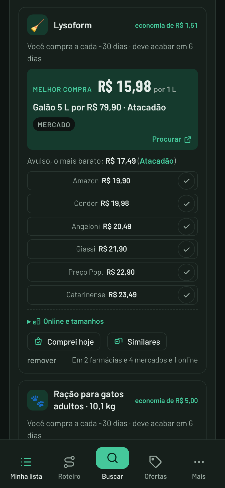
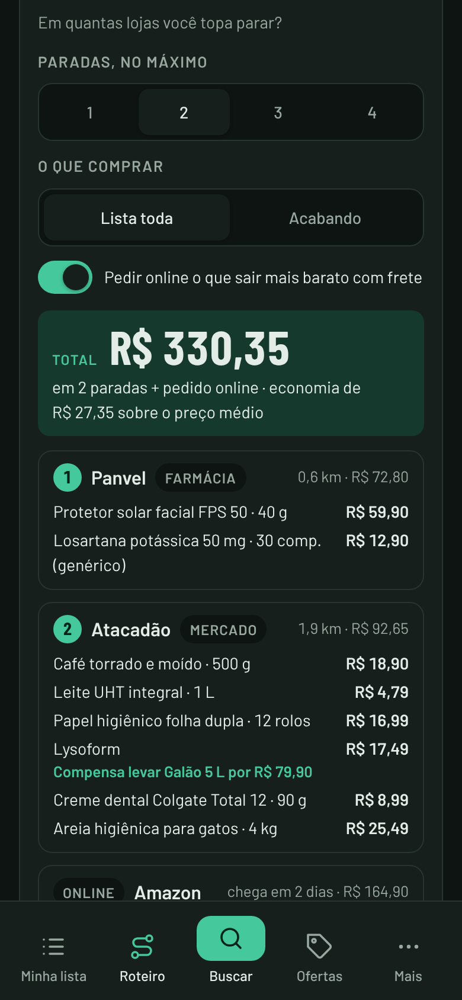
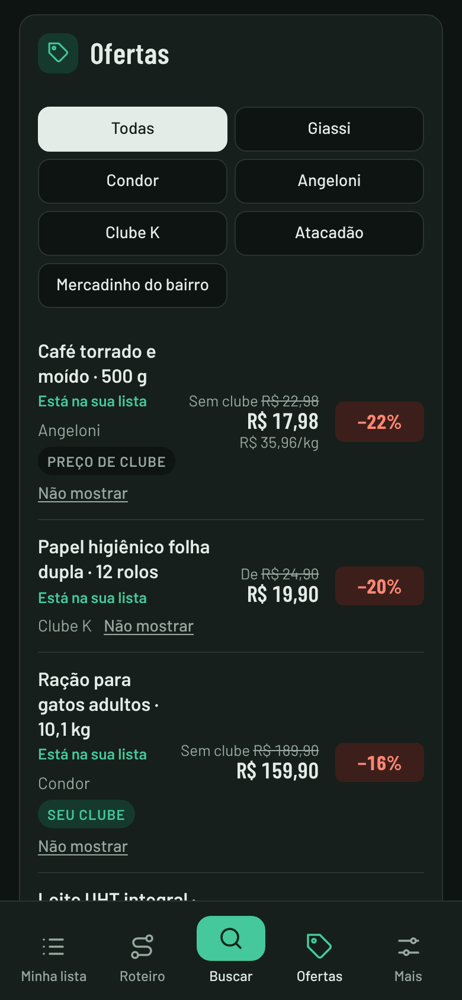

# EconomIA para Home Assistant


Um App do Home Assistant para **economizar nas compras da casa**: uma **lista de compras única** comparada nas **farmácias, mercados e pet shops perto do seu CEP** e no **online** (iFood, Mercado Livre, Amazon e outros), com o **melhor tamanho** de cada produto, um **roteiro** de onde comprar cada item e **leitura por IA** de encartes, prints e mensagens do WhatsApp.

<p align="center">
  
  
  
  
</p>

## Instalação

1. No Home Assistant: **Configurações → Aplicativos → Loja de aplicativos**.
2. No menu **⋮ → Repositórios**, adicione:
   ```
   https://github.com/diegozapella63/economia-ha
   ```
3. Procure **EconomIA** na loja, toque em **Instalar** e depois em **Iniciar**.
4. Ative **Mostrar na barra lateral**.

Ou adicione o repositório direto pelo botão:

[](https://my.home-assistant.io/redirect/supervisor_add_addon_repository/?repository_url=https%3A%2F%2Fgithub.com%2Fdiegozapella63%2Feconomia-ha)

A primeira instalação leva alguns minutos, porque o app é montado no próprio Home Assistant. Depois, as atualizações aparecem sozinhas, com o botão **Atualizar**.

A busca começa pelo que não gasta IA (os sites das lojas, os folhetos e a Shopee). Para o resto, o app usa a IA do seu Home Assistant (Anthropic, OpenAI, Google Gemini...) com busca na web; para ler fotos, uma tarefa de IA que aceite imagens. Escolha e teste em **Mais → Integrações → IA do Home Assistant**.

## O que tem

- **Cupom de economia** saindo da impressora, no alto da Minha lista: quanto dá para economizar na sua lista e os itens que mais economizam, além das oportunidades do dia.
- **Minha lista** única para farmácias, mercados, pet shops e online, com um ícone por item e o ritmo de compra de cada um ("deve acabar em 6 dias"). O **Histórico** põe de volta, com um toque, o que já esteve na lista.
- **Código de barras**: foto ou números do código, e o produto entra na lista; o mesmo produto é achado nas lojas mesmo com outro nome.
- **"Quis dizer…?"**: corrige o nome escrito errado pelas palavras dos produtos das lojas.
- **Melhor tamanho**: compara o preço por litro, quilo ou unidade (1 L, galão de 5 L, 5 × 1 L, kits online com frete) e diz quanto tempo dura no seu ritmo.
- **Sua escolha e similares**: o ✓ fixa a loja ou o tamanho que você prefere, mesmo que não seja o mais barato, e **Similares** mostra até 3 produtos parecidos mais em conta pelo preço do quilo ou do litro.
- **Roteiro de compras**: diga em até quantas lojas topa parar e o app testa as combinações, mostra onde comprar cada item, a ordem e a rota no Maps.
- **Lojas perto de casa pelo mapa**: a zona Casa do Home Assistant e o OpenStreetMap (e o Google Maps, com chave) dizem quais lojas existem perto, com a distância certa. **Encontrar lojas** e **Testar agora** mostram de onde sai o preço de cada loja, com o passo a passo em "Como foi testado".
- **Primeiro o que não gasta IA**: preço direto no site dos mercados que permitem (Giassi, Angeloni e outros testados sozinhos), a busca e as páginas de produto do site (Cobasi, Bistek), a página de ofertas das lojas pequenas, a Shopee pela API de afiliados e o folheto da semana (Kimbino, Portafolhetos, Seus Folhetos e Catálogos Ofertas) ou o encarte do Instagram, lidos uma vez pela IA. A busca na web com IA entra por último, só para o que faltou.
- **Ofertas e cupons** das lojas perto do seu CEP, com o motivo de cada destaque e o botão "Não mostrar".
- **Encartes dos sites**: abre a página de ofertas do mercado do bairro, lê o encarte (imagem ou PDF) com IA e traz os preços. Loja sem preço aparece marcada, com atalho para adicionar o site ou mandar o encarte por foto.
- **Online**: iFood, Rappi, Mercado Livre, Amazon e outros, com frete ou taxa de entrega somados e as assinaturas (Prime, Meli+, Clube iFood), e os mercados da região que entregam no seu CEP, separados.
- **Clubes**: toque em "Sou do clube" na loja e o preço de clube entra nas contas. Cupons da carteira do app entram por print.
- **Leitura por IA**: prints, lista escrita à mão ou mensagem do WhatsApp viram itens da lista. Você confere antes de adicionar.
- **Falar**: o microfone no alto da tela; o Home Assistant transcreve e a IA separa os itens para você conferir.
- **Conversa com a IA**: o balão ao lado do microfone. Pergunte sobre a tela aberta ou sobre qualquer assunto; a IA vê a sua lista, os preços e as ofertas e só sugere (pôr na lista, buscar o preço, abrir uma tela), e nada muda sem o seu toque.
- **No celular e no computador**: arraste para o lado para trocar de aba; no computador, barra lateral com as telas e as ofertas por tipo de loja, e as ações no alto à direita.
- **Lista por voz**: sincroniza com a lista de compras do Home Assistant (Assist, Alexa, Google Tasks).
- **Integrações opcionais**: Google Places (as lojas pequenas), Brave Search (o site das lojas sem site), Mercado Livre (confere a categoria do produto), Instagram das lojas e Shopee Afiliados. As chaves ficam só no Home Assistant.
- **Uso da IA**: quantas chamadas a busca, a leitura de fotos, o Falar e a Conversa fizeram por dia, erros de cota e tokens estimados, com o sensor `sensor.economia_ia_hoje` para painel e automação.
- **Perfil da casa**: quem mora, pets, restrições e interesses decidem o que aparece.
- **Mais, um menu** como nos outros apps: Casa, Lojas, Configurações (Integrações, Dados, Aparência e Opções, com **Usar IA**, sensores opcionais, versões anteriores, exportação para Excel e JSON, tema claro ou escuro e 10 cores) e Sobre.

Mais detalhes em [economia/DOCS.md](economia/DOCS.md).

## Seus dados

Sua lista, perfil e ofertas ficam só no seu Home Assistant, em arquivos abertos (JSON) na pasta do app, e entram nos backups do Home Assistant. Este repositório tem apenas o código do app.

## Estrutura

```
repository.yaml               repositório de apps
economia/                     o app (config, Dockerfile, ícone, manual e mudanças)
economia/app/server.py        servidor, busca e leitura por IA (só biblioteca padrão do Python)
economia/app/voz.py           Falar: fala para texto do Home Assistant (o mesmo módulo do GerencIA)
economia/pagina/painel.html   fonte da página (HTML, CSS e JavaScript num arquivo só, sem framework)
economia/app/www/             a página do add-on, montada da fonte, e as fontes
tests/                        testes unitários, de integração e visuais (veja tests/README.md)
tools/                        montar a página, cobertura dos testes e as imagens deste README
docs/                         imagens deste README e detalhes técnicos
```

## Desenvolvimento

```bash
OFERTAS_ALLOW_ALL=1 OFERTAS_DATA=/tmp/economia OFERTAS_PORT=8099 \
  python3 economia/app/server.py                       # abre em http://127.0.0.1:8099
python3 tools/montar_pagina.py                         # depois de mexer em economia/pagina/painel.html
python3 -m unittest discover -s tests -p "test_*.py"   # testes unitários e de integração
tests/e2e/run.sh                                       # testes visuais (Playwright)
python3 tools/prints_readme.py                         # refaz as imagens deste README
```

Sem `ofertas.json`, a página mostra um exemplo embutido. `OFERTAS_HA_API` aponta para uma API do Home Assistant de teste e `SUPERVISOR_TOKEN` define a chave. Rotas e formato dos arquivos em [docs/tecnico.md](docs/tecnico.md). O `AGENTS.md` explica a estrutura, como testar e como lançar uma versão (vale para qualquer pessoa ou assistente de IA). Os testes rodam no GitHub a cada push.

## Créditos

Fontes [Barlow](https://fonts.google.com/specimen/Barlow) e [Barlow Condensed](https://fonts.google.com/specimen/Barlow+Condensed) (SIL Open Font License).
