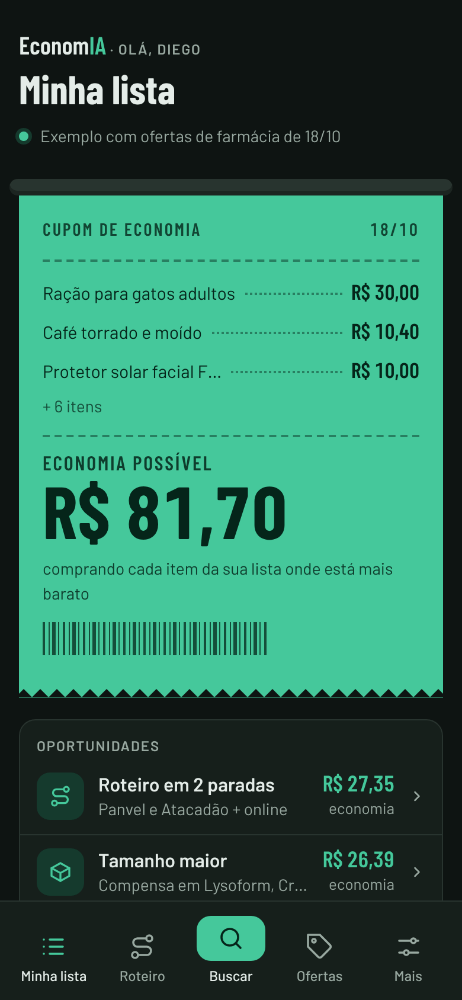
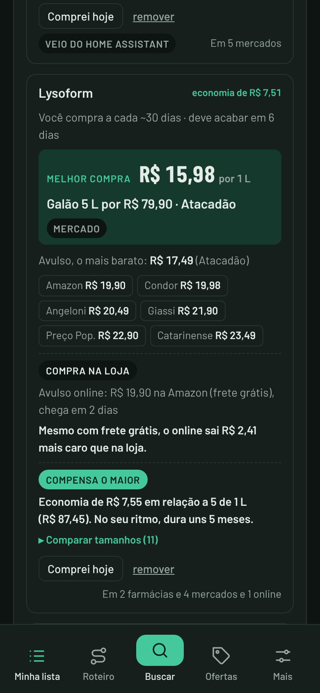
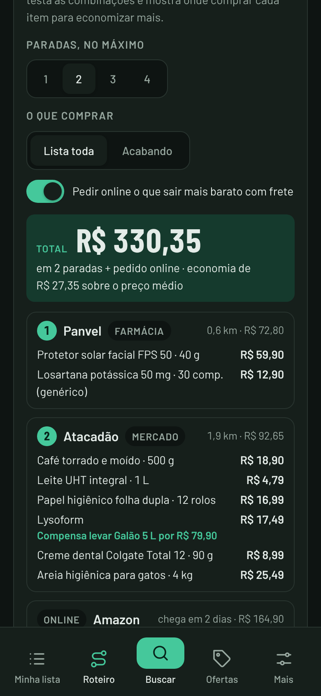
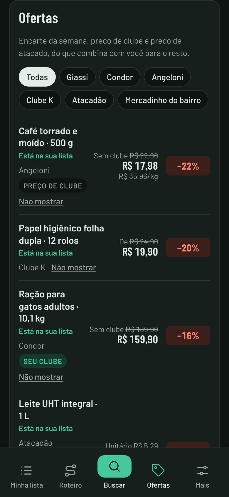

# EconomIA para Home Assistant


Um App do Home Assistant para **economizar nas compras da casa**: uma **lista de compras única** comparada nas **farmácias, mercados e pet shops perto do seu CEP** e no **online** (iFood, Mercado Livre, Amazon e outros), com o **melhor tamanho** de cada produto, um **roteiro** de onde comprar cada item e **leitura por IA** de encartes, prints e mensagens do WhatsApp.

<p align="center">
  
  
  
  
</p>

## Instalação

1. No Home Assistant: **Configurações → Aplicativos → Loja de aplicativos**.
2. No menu **⋮ → Repositórios**, adicione:
   ```
   https://github.com/diegozapella63/economia-ha
   ```
3. Procure **EconomIA** na loja, toque em **Instalar** e depois em **Iniciar**.
4. Ative **Mostrar na barra lateral**.

Ou adicione o repositório direto pelo botão:

[](https://my.home-assistant.io/redirect/supervisor_add_addon_repository/?repository_url=https%3A%2F%2Fgithub.com%2Fdiegozapella63%2Feconomia-ha)

A primeira instalação leva alguns minutos, porque o app é montado no próprio Home Assistant. Depois, as atualizações aparecem sozinhas, com o botão **Atualizar**.

Para buscar ofertas, o app usa a IA do seu Home Assistant (Anthropic, OpenAI, Google Gemini...) com busca na web; para ler fotos, uma tarefa de IA que aceite imagens. Escolha e teste em **Mais → IA do Home Assistant**.

## O que tem

- **Início** com um cupom fiscal saindo da impressora: quanto dá para economizar na sua lista e os itens que mais economizam, além das oportunidades do dia.
- **Minha lista** única para farmácias, mercados, pet shops e online, com o ritmo de compra de cada item ("deve acabar em 6 dias").
- **Melhor tamanho**: compara o preço por litro, quilo ou unidade (1 L, galão de 5 L, 5 × 1 L, kits online com frete) e diz quanto tempo dura no seu ritmo.
- **Roteiro de compras**: diga em até quantas lojas topa parar e o app testa as combinações, mostra onde comprar cada item, a ordem e a rota no Maps.
- **Ofertas e cupons** das lojas perto do seu CEP, com o motivo de cada destaque e o botão "Não mostrar".
- **Encartes dos sites**: abre a página de ofertas do mercado do bairro, lê o encarte (imagem ou PDF) com IA e traz os preços. Loja sem preço aparece marcada, com atalho para adicionar o site.
- **Online**: iFood, Rappi, Mercado Livre, Amazon e outros, com frete ou taxa de entrega somados e as assinaturas (Prime, Meli+, Clube iFood).
- **Clubes**: marque "Sou do clube" e o preço de clube entra nas contas. Cupons da carteira do app entram por print.
- **Leitura por IA**: prints, lista escrita à mão ou mensagem do WhatsApp viram itens da lista. Você confere antes de adicionar.
- **Falar**: o microfone no alto da tela; o Home Assistant transcreve e a IA separa os itens para você conferir.
- **No computador**: barra lateral com as telas e as ofertas por tipo de loja, e as ações no alto à direita.
- **Lista por voz**: sincroniza com a lista de compras do Home Assistant (Assist, Alexa, Google Tasks).
- **Uso da IA**: quantas chamadas a busca e a leitura de fotos fizeram por dia, erros de cota e tokens estimados, com o sensor `sensor.economia_ia_hoje` para painel e automação.
- **Perfil da casa**: quem mora, pets, restrições e interesses decidem o que aparece.
- **Mais em abas** (Casa, Lojas, Integrações, Dados, Aparência e Opções), com **Usar IA**, sensores opcionais, versões anteriores, exportação para Excel e JSON, tema claro ou escuro e 10 cores.

Mais detalhes em [economia/DOCS.md](economia/DOCS.md).

## Seus dados

Sua lista, perfil e ofertas ficam só no seu Home Assistant, em arquivos abertos (JSON) na pasta do app, e entram nos backups do Home Assistant. Este repositório tem apenas o código do app.

## Estrutura

```
repository.yaml          repositório de apps
economia/                o app (config, Dockerfile, ícone, documentação)
economia/app/server.py   servidor, busca e leitura por IA (só biblioteca padrão do Python)
economia/app/voz.py      Falar: fala para texto do Home Assistant (o mesmo módulo do GerencIA)
economia/app/www/        interface (HTML, CSS e JavaScript num arquivo só, sem etapa de build) e fontes
docs/                    imagens deste README e detalhes técnicos
```

## Desenvolvimento

```bash
cd economia/app
OFERTAS_ALLOW_ALL=1 OFERTAS_DATA=./.data OFERTAS_MEDIA=./.media OFERTAS_PORT=8099 \
  python3 server.py                                  # abre em http://127.0.0.1:8099
```

Sem `ofertas.json`, a página mostra um exemplo embutido. `OFERTAS_HA_API` aponta para uma API do Home Assistant de teste e `SUPERVISOR_TOKEN` define a chave. Rotas e formato dos arquivos em [docs/tecnico.md](docs/tecnico.md).

## Créditos

Fontes [Barlow](https://fonts.google.com/specimen/Barlow) e [Barlow Condensed](https://fonts.google.com/specimen/Barlow+Condensed) (SIL Open Font License).
